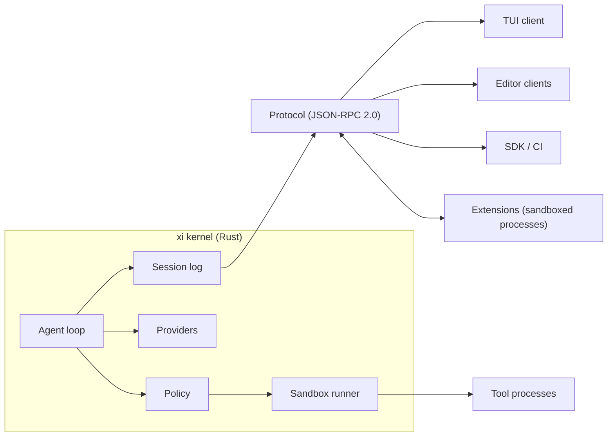

# xi design

xi is a coding agent harness built around a small Rust kernel. The kernel runs the agent loop, owns the session log, enforces the sandbox and policy, and speaks one typed protocol. Tools, UIs, MCP bridges and workflow features are extensions or clients of that protocol.

This document records the design decisions and the reasons behind them. Status of each part is tracked in [Crate map](#crate-map).

## Goals

- A kernel small enough to audit in an afternoon.
- One extension mechanism that the built-in tools also use.
- Safe by default: the agent runs without per-command prompts because the sandbox, not the user, is the first line of defense.
- Prompt-cache-friendly context handling, because caching dominates cost and latency.
- Sessions that can be branched, replayed and audited.

## Non-goals

- Bundled MCP, plan mode, todo lists, memory systems or multi-agent orchestration. These ship as optional packages.
- A plugin marketplace before the capability model is enforced.
- Protecting against a malicious user. The user owns the machine; xi protects the user from the model, from untrusted content and from third-party extensions.

## Lessons this design builds on

| Source | Lesson | Consequence in xi |
|---|---|---|
| Pi | Frontier models need few tools and a short system prompt. | Five default tools; system prompt under 1k tokens. |
| Pi | Extensions an LLM can write and hot-reload turn users into contributors. | The extension protocol is the main product surface; the TypeScript SDK is first-class. |
| Pi | Tree-shaped sessions make branching cheap. | The session log is an event tree. |
| Claude Code | Skills with progressive disclosure work; eager MCP tool schemas waste context. | Skills in core, MCP as an extension. |
| Claude Code | Subagents help through context isolation. | A subagent is a child session with a reduced tool set. |
| Claude Code | Per-command approval causes fatigue and gets disabled. | Sandbox plus policy; prompts only at boundary crossings. |
| Claude Code | Project config that executes code before trust is a vulnerability class. | Workspace trust gates every repo-supplied hook, extension and loosening rule. |
| Codex CLI | A native core makes OS sandboxing and distribution simple. | Rust kernel, single static binary. |

## Architecture



### Kernel

The kernel is a long-running process per workspace. It is headless; every UI is a client. Responsibilities:

1. Run the agent loop: build context, call the model, dispatch tool calls, append results.
2. Own the session log and broadcast every appended event.
3. Evaluate policy for every boundary crossing and run tools inside the sandbox.
4. Spawn, supervise and route to extensions.

Anything not on that list belongs in an extension or a client.

### Session log

A session is an append-only JSONL file. Every line is one event with an id, an optional parent id, a timestamp and a typed payload. Parent links form a tree:

- Exactly one root, a `session_started` event.
- Every other event names a parent that appears earlier in the file.
- Branching means appending a child to an older event. Nothing is rewritten.
- The path from the root to any event is a complete conversation.
- A `compaction` event summarizes its ancestors. Context for a leaf is the latest compaction summary on its path plus the events after it. The summarized events stay in the file.

Durability: each append is written as one buffer and synced before it is acknowledged. An unterminated final line can only come from an append that was never acknowledged, so opening a session truncates it. A malformed complete line is corruption and fails the open with its line number.

One kernel owns a session at a time; the file is locked exclusively while open.

The log doubles as the audit trail (policy decisions and approvals are events), the replay input for evals, and the source of cost accounting (`usage` on assistant messages).

### Protocol

All process boundaries use JSON-RPC 2.0 over stdio or a Unix socket. Methods are typed in `xi-protocol` with one marker type per method, following the pattern of `lsp-types`.

Client methods:

| Method | Direction | Purpose |
|---|---|---|
| `session/create`, `session/open` | client → kernel | Start or resume a session. |
| `session/prompt` | client → kernel | Run a turn; returns the new head when the turn ends. |
| `session/cancel` | client → kernel | Stop the running turn. |
| `session/checkout` | client → kernel | Move the head to an earlier event to branch. |
| `approval/resolve` | client → kernel | Answer an `ask` decision. |
| `event/appended` | kernel → client | Every persisted event. |
| `stream/delta` | kernel → client | Streaming model output; not persisted. |

Approvals are events, not blocking requests. Any attached client can answer, and the decision lands in the log.

Extension methods:

| Method | Direction | Purpose |
|---|---|---|
| `initialize` | kernel → extension | Handshake; the extension returns the tools, hooks and commands it registers. |
| `tool/invoke` | kernel → extension | Run a registered tool. |
| `hook/run` | kernel → extension | Run a hook at a loop point. |
| `command/run` | kernel → extension | Run a slash command. |
| `shutdown` | kernel → extension | Ask the extension to exit. |
| `session/append_custom` | extension → kernel | Persist extension state as a `custom` event. |
| `log` | extension → kernel | Diagnostic output. |

Hook points in protocol version 0: `pre_tool` (continue, deny, or rewrite the input), `post_tool` (continue or replace the output), `turn_end` (observe only). Compaction and pre-model hooks wait until the context builder exists, so their payloads match real data.

### Extensions

An extension is a package with a static manifest and an executable:

```toml
name = "web"
version = "0.1.0"
run = ["bun", "run", "index.ts"]

[capabilities]
net = ["*.wikipedia.org"]
fs_read = []
fs_write = []
env = []
exec = false
```

Capabilities live in the static manifest because the kernel needs them to build the sandbox before the process starts. What the extension registers (tools, hooks, commands) comes from `initialize`, so extensions can register dynamically and hot-reload by restarting.

The built-in tools are an extension compiled into the binary and spoken to over the same protocol. If the API can't express a built-in, the API is wrong.

Packages are pinned by content hash in a lockfile. Install never runs package scripts.

### Providers

The provider layer converts between xi content blocks and each provider's wire format. Conversion is lossless: thinking signatures, redacted thinking and provider-specific blocks round-trip through `thinking` and `opaque` blocks. Model metadata (context window, pricing, capabilities) comes from a registry file, not code.

Context is built to keep the cached prefix stable: the system prompt has no timestamps or dynamic state, history is append-only, and compaction is the only operation that changes the prefix.

## Security model

Threats, in order of likelihood:

1. Prompt injection through content the agent reads: web pages, issues, dependencies, files in an unfamiliar repo.
2. Model mistakes with destructive side effects.
3. Malicious or compromised extensions.
4. A malicious repository that ships config, hooks or extensions.

### Sandbox

Every tool process and extension runs sandboxed. The kernel never restricts itself; it starts each process through the `xi-sandbox-exec` helper, which enters the sandbox and then execs the target. Doing the setup in a separate single-threaded process keeps it out of the unsafe window between `fork` and `exec` in the multi-threaded kernel.

- Writes: the workspace and a per-session tmp directory. Linux mounts the latter at `/tmp`; workspaces under the host `/tmp` keep their paths. macOS cannot remount and instead sets `TMPDIR` to the session directory. The real `/tmp`, `/private/tmp` and `/private/var/folders` stay unwritable except for explicitly writable roots.
- Reads: system paths, every `PATH` directory except the home directory and its ancestors, `CARGO_HOME`, `RUSTUP_HOME`, common toolchain roots (mise installs, Homebrew, Nix profiles), skills, and the session's spill and git directories. The rest of the home directory is not readable, so credential stores (`~/.ssh`, `~/.aws`, `~/.config/gh`, `.netrc`) are covered without a denylist.
- Git: `GIT_CONFIG_GLOBAL` points at a per-session config holding the user's name, email and global ignore patterns, with signing off. The user's own global config stays unreadable, because it can name hooks, credential helpers and signing keys that need secrets. On macOS, git also exits when its global config is unreadable.
- Protected paths: `.git/config`, `.git/hooks` and `.xi` are read-only even inside the writable workspace. Missing ones are created empty first, so the sandbox can't create them. Hooks and repo config run code outside the sandbox the next time the user runs git, and `.xi` holds policy.
- Environment: cleared except for an allowlist; `TMPDIR` is `/tmp` on Linux and the session tmp path on macOS.
- Network: Linux uses a private network namespace with only loopback. macOS denies all IP networking, including connections to host localhost servers and binding in-sandbox loopback servers. `Network::Host` allows host IP networking on either platform. The only additional macOS Unix socket access is the system DNS resolver described below.
- Terminal: the helper starts a new session, so there's no controlling terminal to push input into with `TIOCSTI`.

Setup failures exit 125, an unrunnable program 126 and a missing program 127. The macOS helper resolves the program on `PATH` before sandboxing, then execs `sandbox-exec`, which execs a second helper stage that execs the target. Every exec preserves the helper's pid and process group. The internal stage requires a launcher marker, removes it from the target environment, and maps target exec failures to 126/127. Failures within Apple's profile installation itself retain `sandbox-exec`'s native status rather than 125.

#### Linux mechanism

| Layer | What it enforces |
|---|---|
| User namespace | Lets an unprivileged process create the other namespaces. The user's uid and gid map to themselves. |
| Mount namespace | Private `/tmp` and `/dev/shm`, plus read-only bind mounts for protected paths. Writable ancestors are bind-mounted onto themselves first, so renaming `.git` cannot move a protected child out of the policy. |
| Network namespace | No route to any host. Landlock's network rules filter by port only, so they can't express "the proxy on loopback but nothing else". |
| Landlock (ABI 9) | Filesystem access, connecting to pathname Unix sockets (agent sockets, `docker.sock`), and signals and abstract Unix sockets outside the sandbox. Sets `no_new_privs`, which disables setuid binaries. |

The helper refuses to run if the kernel enforces Landlock only partially, unless the spec sets `allow_partial`. ABI 9 shipped in Linux 7.1; older kernels can't mediate Unix socket connections.

#### macOS mechanism

| Layer | What it enforces |
|---|---|
| Seatbelt via `/usr/bin/sandbox-exec` | A generated, deny-by-default SBPL profile inherited by descendants. Missing `sandbox-exec` fails closed. `allow_partial` has no effect. |
| Filesystem rules | Reads of system runtime/toolchain roots and explicit read/write roots. Writes only to writable roots, session tmp and limited device nodes. Protected paths get final write/create denies, with ancestor rename/unlink denied to prevent moving them out of the policy. Missing protected paths are created first, as on Linux. |
| Socket rules | Pathname Unix socket connections and binds only beneath writable roots and session tmp. Isolated denies TCP/UDP, including IPv4 and IPv6 loopback. Host enables IP networking and connection to exactly `/private/var/run/mDNSResponder` for native DNS, not arbitrary Unix sockets such as SSH agents or Docker. The DNS exception is absent in Isolated. |
| Process rules | Fork/exec allowed; signals and process-info limited to the same sandbox. `setsid` detaches the controlling terminal. Only ptys created by the sandbox receive tty access. |
| Mach/sysctl rules | Only account lookup in the base profile. Host additionally permits named DNS/network configuration and TLS trust-evaluation services. No `securityd`, `SecurityServer`, task ports, Apple Events or general Mach lookup. Hardware and runtime sysctl reads are allowlisted. |

The macOS system read roots cover `/bin`, `/sbin`, `/usr`, runtime subtrees of `/System`, `/Library/Apple`, frameworks, logging and Xcode license preferences, the Command Line Tools, Xcode, `/private/etc`, timezone data, the shell/developer-directory selectors and dyld caches. They deliberately exclude `/System/Volumes/Data`, arbitrary `/Library` data and user homes. Other toolchain installations need explicit readable roots. Ancestors expose only metadata for traversal, except the literal `/` directory, which dyld must open when locating its shared cache. Symlink roots also permit reading the link itself, without granting access to a replacement target.

The policy is informed by [Codex's base profile](https://github.com/openai/codex/blob/main/codex-rs/sandboxing/src/seatbelt_base_policy.sbpl), its [restricted-read defaults](https://github.com/openai/codex/blob/main/codex-rs/sandboxing/src/seatbelt_read_only_platform_defaults.sbpl), and [Anthropic sandbox-runtime](https://github.com/anthropics/sandbox-runtime/blob/main/src/sandbox/macos-sandbox-utils.ts). Their broader GUI, keychain and IPC allowances are not adopted.

#### Known gaps

- Seatbelt and `sandbox-exec` are deprecated Apple interfaces, although still available. There is no private network namespace or `/tmp` mount on macOS, so tools must honor `TMPDIR`; isolated localhost servers cannot run. No best-effort fallback is used.
- On macOS, git treats `EPERM` on an unreadable `~/.config/git/config` or `~/.gitconfig` as fatal. The kernel avoids this with the session git config above; other callers of the helper must set `GIT_CONFIG_GLOBAL` themselves.
- No PID namespace on Linux: other processes' command lines are visible in `/proc`. Their environments and memory are not, because Landlock blocks ptrace-mode access outside the sandbox.
- No seccomp filter yet. With namespaces and Landlock in place, its remaining job would be reducing kernel attack surface (`io_uring`, `bpf`, `userfaultfd`).
- A repository created inside the sandbox with `git init` has unprotected hooks until a later spec sees its `.git`. Hooks planted in that window persist.
- Platforms other than Linux and macOS fail closed. macOS paths that cannot be represented losslessly in the generated profile (non-UTF-8 or control characters) fail setup rather than widening permissions.

`--yolo` disables the sandbox and refuses to start unless xi detects it is inside a container or VM.

### Egress

All network traffic from sandboxed processes goes through an HTTP(S) CONNECT proxy run by the kernel. The proxy sees the destination host and asks policy before connecting. Provider API calls originate in the kernel and never pass through tool processes.

On Linux the proxy listens on a Unix socket in the session directory. Inside the sandbox's network namespace a small forwarder listens on loopback and relays to that socket, and `HTTP_PROXY`/`HTTPS_PROXY` point at the forwarder. The network namespace is what stops a process from connecting to any host directly.

### Policy

Policy decides what happens at a boundary crossing: network egress, reads or writes outside the sandbox, specific commands, and tool use. Inside the sandbox nothing is asked.

Rules are data:

```toml
[[rule]]
effect = "allow"            # allow | ask | deny
action = "net"              # exec | read | write | net | tool
pattern = "*.github.com"    # glob over the action's subject
when = "always"             # always | tainted | clean
```

Evaluation:

1. With no matching rule, the decision is `ask`.
2. Layers with full authority (built-in, user, and the workspace-local file once the workspace is trusted) apply in order. The last matching rule wins.
3. Tighten-only layers (the committed project file, and the local file in an untrusted workspace) apply afterwards. A matching rule replaces the decision only when it is stricter. Their `allow` rules never take effect.
4. If the session is tainted and the result is `allow` for egress, the decision becomes `ask`, unless the rule that allowed it was written with `when = "tainted"`.

For path subjects, `*` does not cross `/`; use `**`. Path patterns are absolute; `~` is not expanded yet. Host patterns match case-insensitively.

### Taint

The kernel marks a session tainted when it ingests untrusted content: output of fetch tools, or tool output an extension flags as untrusted. A `tainted` event records the cause. Taint never clears on a branch that contains the event; it does not apply to sibling branches.

This addresses the combination of private data, untrusted content and an exfiltration channel. Rather than trusting the model to resist injected instructions, the kernel cuts the exfiltration channel back to explicit approval.

### Workspace trust

Opening a repository for the first time loads no repo-supplied hooks, extensions or loosening rules. The committed project policy still applies, because it can only tighten. The user grants trust once per repository root; trust is stored outside the repository.

### Secrets

Provider credentials live in the kernel, loaded from the OS keychain or a user-only file. They are never placed in a tool or extension environment.

## Defaults

- Tools: `read`, `edit`, `write`, `bash`, `search`. Edits are anchored to a content hash of the lines being replaced, so a stale view fails loudly. Large outputs are truncated in context and spilled to a file the model can read.
- Context files: `AGENTS.md` and Agent Skills.
- System prompt: under 1k tokens, static.
- Compaction: user-visible; produces a structured summary (goal, decisions, touched files, open work).
- TUI: differential rendering into the terminal's native scrollback.
- Config: one TOML format, layered global, project, local.

## Crate map

| Crate | Purpose | Status |
|---|---|---|
| `xi-protocol` | Event, content, JSON-RPC envelope, method and manifest types. | Implemented |
| `xi-session` | Append-only session tree log with crash recovery and locking. | Implemented |
| `xi-policy` | Policy rules, layering and taint-aware evaluation. | Implemented |
| `xi-sandbox` | `xi-sandbox-exec` helper; Linux namespaces and Landlock, macOS Seatbelt. | Implemented |
| `xi-sandbox` egress proxy | Kernel-side CONNECT proxy and in-namespace forwarder. | Planned |
| `xi-provider` | Anthropic Messages and OpenAI-compatible Chat adapters, model registry. | Implemented (Anthropic live path untested) |
| `xi-tools` | `read`, `edit`, `write`, `bash`, `search`, plus `replace` for edit-format comparisons. | Implemented |
| `xi-kernel` | Agent loop, context builder, layered config, workspace trust, JSON-RPC server. | Implemented; extension host planned |
| `xi-cli` | The `xi` binary: line mode, headless `-p`, `serve`, `trust`. | Implemented |
| `xi-bench` | Runs xi and omp arms on a task suite and reports metrics. | Implemented |
| `xi-tui` | Terminal client. | Planned |
| `sdk/typescript` | Extension and client SDK. | Planned |

## Build order

1. `xi-sandbox` on Linux and macOS. Done.
2. `xi-provider`, `xi-kernel`, `xi-tools` and a line-mode client: the first usable agent. Done.
3. `xi-bench`, so features are added on measurements. Done.

What comes next, and how features and sandbox work proceed side by side, is in [roadmap.md](roadmap.md).

## Open questions

- Whether the kernel should be one process per workspace or one per user with workspaces as tenants.
- Wasm components as a second extension format once the component toolchain is easy enough for models to target.
- Whether edits should use line-hash anchors or AST-aware anchors by default.
