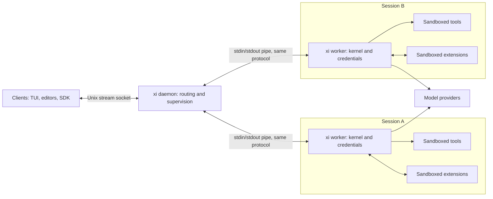

# xi design

xi is a coding agent harness built around a small Rust kernel. The kernel runs the agent loop, owns the session log, enforces the sandbox and policy, and speaks one typed protocol. Tools, UIs, MCP bridges and workflow features are extensions or clients of that protocol.

This document records the design decisions and the reasons behind them. Status of each part is tracked in [Crate map](#crate-map).

## Goals

- A kernel small enough to audit in an afternoon.
- One extension mechanism that the built-in tools also use.
- Safe by default: the agent runs without per-command prompts because the sandbox, not the user, is the first line of defense.
- Prompt-cache-friendly context handling, because caching dominates cost and latency.
- Sessions that can be branched, replayed and audited.

## Non-goals

- Bundled MCP, plan mode, todo lists, memory systems or multi-agent orchestration. These ship as optional packages.
- A plugin marketplace before the capability model is enforced.
- Protecting against a malicious user. The user owns the machine; xi protects the user from the model, from untrusted content and from third-party extensions.

## Lessons this design builds on

| Source | Lesson | Consequence in xi |
|---|---|---|
| Pi | Frontier models need few tools and a short system prompt. | Five default tools; system prompt under 1k tokens. |
| Pi | Extensions an LLM can write and hot-reload turn users into contributors. | The extension protocol is the main product surface; the TypeScript SDK is first-class. |
| Pi | Tree-shaped sessions make branching cheap. | The session log is an event tree. |
| Claude Code | Skills with progressive disclosure work; eager MCP tool schemas waste context. | Skills in core, MCP as an extension. |
| Claude Code | Subagents help through context isolation. | A subagent is a child session with a reduced tool set. |
| Claude Code | Per-command approval causes fatigue and gets disabled. | Sandbox plus policy; prompts only at boundary crossings. |
| Claude Code | Project config that executes code before trust is a vulnerability class. | Workspace trust gates every repo-supplied hook, extension and loosening rule. |
| Codex CLI | A native core makes OS sandboxing and distribution simple. | Rust kernel, single static binary. |

## Architecture



### Processes

The topology is one daemon per OS user per machine, with one worker process per open session. Per-user scope gives clients one known socket, a session list, an approvals inbox and a model-request scheduler. Workspace boundaries are ambiguous between cwd, git root and worktree; each session already records its `cwd`. A workspace socket would still need to live outside the repository to stay outside the sandbox. Separate workers contain provider-parsing panics and leaks to one session. Jupyter uses a per-user server with a kernel process per notebook; Docker uses a daemon and per-container shims. In contrast, one tmux server crash loses every session.

| Process | Count | Owns | Never does |
|---|---|---|---|
| `xi daemon` | One per OS user per machine | Client socket, version handshake, session index, worker supervision, per-session routing, approvals inbox, model-request scheduler | Model calls, tools, provider-stream parsing, holding credentials |
| `xi worker` (internal subcommand) | One per open session | Session log and its exclusive lock, agent loop, provider credentials, policy, sandboxed tools, the session's extension host, subagent children | Listen on a socket |
| Clients: TUI, editors, `xi -p`, SDK | Any | UI | Touch logs directly |

The client socket and worker pipes carry NDJSON JSON-RPC 2.0 with the same framing and method types. The daemon forwards session requests; workers hold credentials and call providers. `agent/run` children run inside the parent's worker. Socket paths and access checks are in [Daemon socket](#daemon-socket); method names, routing and approvals are in [Protocol](#protocol).

Line mode and the TUI connect through `xi-client`, which autostarts the per-user daemon if needed. They create a session or open its log for `--resume`. Quitting detaches and closes the worker only if its session is idle.

Each worker runs the kernel with these responsibilities:

1. Run the agent loop: build context, call the model, dispatch tool calls, append results.
2. Own the session log and broadcast every appended event.
3. Evaluate policy for every boundary crossing and run tools inside the sandbox.
4. Spawn, supervise and route to extensions.

Other agent behavior belongs in an extension or a client.

#### Lifecycle

| Transition | Behavior |
|---|---|
| Start | Use OS socket activation where installed: a launchd LaunchAgent with a `Sockets` entry on macOS, or a systemd user `.socket` unit on Linux. Otherwise a client finding no listener spawns `xi daemon`, and reports the daemon's exit status if it exits before listening. The daemon takes an exclusive lock on `daemon.lock` before binding; a losing racer exits and the client retries the connection. Without an activation descriptor, the daemon refuses to replace a socket that still accepts connections and removes an existing socket only when connecting to it is refused. |
| Daemon idle exit | Exit with no workers and no connected clients after `[daemon] idle_exit`, default 10 minutes. |
| Client detach | Closing a client cancels nothing. Turns keep running and any client can attach later. Cancellation requires an explicit request. |
| Worker exit | Exit when the session is closed, or when idle with no attached clients for `idle_exit`. |
| Worker crash | The daemon broadcasts the exit status. The log remains intact; opening it resumes the session in a new worker. |
| Daemon death | Workers see EOF on their pipe and abort in-flight model requests. They let the running tool batch finish, record its results, append `turn_failed` with `"daemon connection lost"`, then exit. The session resumes in a new worker. |
| Upgrade | Workers keep the binary they started with until they exit. When its executable changes on disk, the daemon exits once it has no workers and no clients. The next connection starts the new binary through socket activation or client autostart. The client handshake requires an exact protocol version match. An idle shutdown request lets a newer client request a restart once workers finish. |

`xi -p`, `xi serve`, the benchmark and tests use a private instance: the daemon library runs in-process with no listener and no runtime directory. The CLI and benchmark spawn worker processes; tests and the TUI demo can inject in-process workers. The last client disconnect shuts the instance and its workers down. `xi serve` speaks the client protocol over stdio as the private instance's one client. This uses the real daemon's code paths without shared state between benchmark trials. Benchmark argv does not change.

#### Model-request scheduling

`[[daemon.limit]]` entries set an `endpoint` (provider base URL) and `concurrency` (maximum simultaneous model requests). Endpoints without an entry are unlimited. Before each model request, a worker requests an endpoint lease and waits for a grant. Leases are FIFO per endpoint. The worker releases its lease when the response ends, fails or is cancelled; worker exit releases leases implicitly. Retries of the same request keep the lease. Lease method names are in [Protocol](#protocol).

#### Scope

A remote network listener is deliberately not provided. Remote clients forward the Unix socket over SSH; local socket activation is available through the launchd and systemd units installed by `xi daemon install`.

### Session log

A session is an append-only JSONL file. Every line is one event with an id, an optional parent id, a timestamp and a typed payload. Parent links form a tree:

- Exactly one root, a `session_started` event.
- Every other event names a parent that appears earlier in the file.
- Branching means appending a child to an older event. Nothing is rewritten.
- The path from the root to any event is a complete conversation.
- A `compaction` event summarizes older ancestors. Context for a leaf is the latest summary, the ancestor tail named by `kept`, then the events after compaction. The summarized events stay in the file.

Durability: each append is written as one buffer and synced before it is acknowledged. An unterminated final line can only come from an append that was never acknowledged, so opening a session truncates it. A malformed complete line is corruption and fails the open with its line number.

One worker owns a session at a time; the file is locked exclusively while open.

The log doubles as the audit trail (policy decisions and approvals are events), the replay input for evals, and the source of cost accounting (`usage` on assistant messages).

### Protocol

All links use newline-delimited JSON (NDJSON), with one JSON-RPC 2.0 message per line. Types live in `xi-protocol`, with one marker type per method, following the pattern of `lsp-types`.

| Link | Transport |
|---|---|
| Client ↔ daemon | Unix stream socket; in-memory duplex for private clients, or stdio for `xi serve` |
| Daemon ↔ worker | Worker's stdin/stdout pipe |
| Worker ↔ extension | Stdio |

The first client request must be `initialize`. The daemon requires an exact `protocol_version` match with `xi_protocol::PROTOCOL_VERSION`, currently 0. Any other request before initialization fails with -32001, and a version mismatch fails with -32002.

Client → daemon requests:

| Method | Params → result | Purpose |
|---|---|---|
| `initialize` | `{protocol_version, client: {name, version}}` → `{protocol_version, daemon_version, capabilities: {private}}` | Initialize the connection and require the exact protocol version. `private` is true when the daemon has no listener. |
| `session/create` | `{cwd, model?, options}` → attach result | Spawn a worker and attach the caller. |
| `session/open` | `{path, options}` → attach result | Spawn a worker for an existing log. If a live worker holds the same canonical path, fail with -32005 and return its session id so the client can attach instead. |
| `session/attach` | `{session, since?}` → `{info, events, partial, running, pending_approvals, stream_sequence}` | Subscribe the connection to the session's notifications. `since` is the last event id the client already has; `events` contains the events after it on disk, or the whole log without `since`. `partial` contains in-flight assistant blocks not yet persisted. |
| `session/detach` | `{session}` → null | Unsubscribe; the turn keeps running. |
| `session/list` | `{cwd?, running?}` → `[{session, path, cwd, model, head, running, pending_approvals, parent_session}]` | List live sessions and sessions found in the session directories; read root lines only. `running` is the worker's own turn state, so a steering prompt left queued after a cancel does not count. |
| `session/close` | `{session}` → null | Stop the worker; fail while a turn runs. Steering prompts left queued after a cancel are rejected with an error. |
| `session/prompt` | `{session, content}` → `{head, failed, cancelled, text}` | Route to the worker; run a turn and return its outcome when it ends. `text` is the final assistant response text. |
| `session/cancel` | `{session}` → null | Route to the worker; stop the running turn. |
| `session/checkout` | `{session, event}` → null | Route to the worker; move the head to an earlier event to branch. Idle only. |
| `session/compact` | `{session}` → `{head, tokens_before}` | Route to the worker; summarize older context at an idle prompt. |
| `session/set_model` | `{session, model}` → null | Idle only; record `model_changed`. |
| `session/set_reasoning` | `{session, reasoning}` → null | Idle only; record `reasoning_changed` when the level changes. Reopening a log restores the last level on the head's lineage. Models without reasoning keep the setting and ignore it. |
| `session/models` | `{session}` → `{current, reasoning, models: [{model, info, available}]}` | Route to the worker; list the session's model registry with `ModelInfo`. `available` is false when the provider's credential is missing. No credential value is ever returned. |
| `session/commands` | `{session}` → `[{name, description}]` | Route to the worker; list the session's extension slash commands for completion. |
| `session/command` | `{session, name, args}` → command result or null | Route an extension slash command to the worker. The result is the extension protocol's `CommandResult`; null means an unknown command. |
| `approval/list` | `{}` → `[{session, call, tool, action, rule}]` | Return pending asks across all sessions. |
| `approval/resolve` | `{session, call, approved, remember?}` → null | Route the answer to the owning worker; the first answer wins. `remember` is `once` (default), `session` or `workspace`; see [Terminal client](#terminal-client). |
| `daemon/status` | `{}` → `{version, pid, uptime_secs, workers, clients, leases}` | Return daemon status. Each lease entry is `{endpoint, concurrency, active, waiting}`. |
| `daemon/shutdown` | `{when: "idle" \| "now"}` → null | `idle` exits when there are no workers; `now` cancels running turns, closes workers and kills any still present after five seconds. |

`SessionOptions` supplies per-invocation settings for both create and open; omitted `options` uses the defaults below. All supplied paths, including `cwd`, the log `path`, and paths in options, must be absolute. The CLI resolves relative paths before connecting; the worker rejects relative paths.

| Option | Type and default | Meaning |
|---|---|---|
| `configs` | Path array, empty | Extra full-authority config layers (`--config`). |
| `session_dir` | Optional path, absent | Session directory override (`--session-dir`). |
| `reasoning` | Optional `Reasoning`, absent | Reasoning depth override (`--reasoning`). |
| `tools` | Optional string array, absent | Enabled tool names override (`--tools`). |
| `extensions` | Path array, empty | Extra extension directories (`--extension`). |
| `max_turns` | Optional integer, absent means 200 | Turn limit (`--max-turns`). |
| `approval` | `ApprovalPolicy`: `client` (default), `allow`, or `deny` | `client` waits for a client approval; `allow` and `deny` resolve asks headlessly. |

The attach result is `{info, events, partial, running, pending_approvals, stream_sequence}` for create, open and attach. `info` is `SessionDetails`: `{session, path, head, cwd, trusted, model, reasoning, model_info?, parent_session?}`. Saved sessions without a live worker have no `head` in `session/list`. The daemon guarantees at-least-once event delivery between an attach result and subsequent `event/appended` notifications, so clients deduplicate events by id. Stream notifications can also arrive twice, because the daemon subscribes a connection before asking the worker for its snapshot; `stream_sequence` is the last stream sequence included in `partial`, and clients drop `stream/delta` and `stream/reset` notifications at or below it. A sequence of 0 means unsequenced and is always applied. The prompt result's `failed`, `cancelled` and `text` fields come from the kernel's `TurnOutcome` and default on deserialization to false, false and an empty string.

Daemon → client notifications go only to connections attached to that session, except where noted:

| Notification | Payload | Recipients and meaning |
|---|---|---|
| `event/appended` | `{session, event}` | Attached clients; every persisted event. |
| `stream/delta` | `{session, delta, attempt, sequence}` | Attached clients; streaming model output, not persisted. `attempt` is an integer starting at 0. `sequence` comes from one counter per worker shared with `stream/reset`. |
| `stream/reset` | `{session, attempt, sequence}` | Attached clients; sent before a retried model request. Clients drop partial text from earlier attempts so retries do not duplicate text. |
| `session/exited` | `{session, status?, message?}` | Attached clients and any client that called `session/list` with `running = true`; reports worker exit. |
| `approval/pending` | `{session, call, tool, action, rule}` | Every initialized connection, not just attached ones; updates the approvals inbox. |

Approvals are events, not blocking requests. The worker remains the authority for its asks; the decision is a `tool_decision` event with `decision = ask`. The daemon exposes one inbox through `approval/list` and routes `approval/resolve` to the owning worker. The first answer wins; later answers fail with -32006. The resolution lands in the log.

With no client attached, the worker waits. The optional `[daemon] notify` command is an argv list from user config only, never project config. The daemon passes the session id, tool and action to it as JSON on stdin. Optional `[daemon] approval_timeout` defaults to none; expiry records `approval_resolved` with `approved = false` and `by = "timeout"`.

When a worker opens a log whose head's lineage has tool calls without results, it first appends a synthetic error `tool_result` with output `"interrupted"` for each. If a call's last decision was an unresolved ask, it appends `approval_resolved { approved: false, by: "interrupted" }` before that result. Cancelled asks record a denial with `by = "cancelled"` before their cancelled tool result, so no ask remains unanswered. `Approver` includes `timeout`, `interrupted` and `cancelled`. See [Processes](#processes) for lifecycle.

On the daemon ↔ worker link, the first request must be `worker/start`. Its response is the readiness signal; any other request before it fails with -32001.

| Method | Direction | Params → result | Purpose |
|---|---|---|---|
| `worker/start` | Daemon → worker request | `{mode: "create", cwd, model?, options}` or `{mode: "open", path, options}` → attach result | Create or open the session. `mode` tags `WorkerStartParams`; the remaining fields are the client create or open params. |
| `model/lease` | Worker → daemon request | `{endpoint}` → null | Wait for permission to make a model request. |
| `model/release` | Worker → daemon notification | `{endpoint}` | Release a granted lease. |

After startup, the daemon forwards `session/attach`, `session/close`, `session/prompt`, `session/cancel`, `session/checkout`, `session/compact`, `session/set_model`, `session/set_reasoning`, `session/models`, `session/commands`, `session/command` and `approval/resolve` unchanged. A worker's attach response is a snapshot, not a subscription; the daemon owns client subscriptions. Workers send `event/appended`, `stream/delta` and `stream/reset` notifications to the daemon. Before each model request a worker requests a lease for the endpoint and waits for a grant. It releases the lease when the response ends, fails or is cancelled. Leases are FIFO per endpoint; retries of the same request keep the lease, and worker exit releases its leases implicitly.

Errors use the JSON-RPC server range; `data` carries structured detail:

| Code | Meaning |
|---|---|
| -32001 | Not initialized |
| -32002 | Protocol version mismatch; `data: {daemon_protocol_version}` |
| -32003 | Unknown session |
| -32004 | Session is running |
| -32005 | Session held by another worker; `data: {session}` when the daemon knows the live holder, otherwise null for a worker's file-lock failure |
| -32006 | Approval not pending |
| -32007 | Worker exited; `data: {status}` |

Extension methods:

| Method | Direction | Purpose |
|---|---|---|
| `initialize` | worker → extension | Handshake; the extension returns the tools, hooks and commands it registers. |
| `tool/invoke` | worker → extension | Run a registered tool. |
| `hook/run` | worker → extension | Run a hook at a loop point. |
| `command/run` | worker → extension | Run a slash command. |
| `shutdown` | worker → extension | Ask the extension to exit. |
| `session/append_custom` | extension → worker | Persist extension state as a `custom` event. |
| `agent/run` | extension → worker | Run a linked child session with a reduced built-in toolset. Requires `subagents`. |
| `log` | extension → worker | Diagnostic output. |

Hook points in protocol version 0: `pre_tool` (continue, deny, or rewrite the input), `post_tool` (continue or replace the output), `turn_end` (observe only), and `compact` (continue or supply a summary). Hooks run in registration order. The host rejects outcomes that do not match their hook point. Rewritten input goes through policy before execution. Replacement output cannot clear a prior untrusted flag.

### Extensions

An extension is a package with a static manifest and an executable:

```toml
name = "subagents"
version = "0.1.0"
run = ["node", "index.ts"]

[capabilities]
subagents = true
net = []
fs_read = ["../../sdk/typescript"]
fs_write = []
env = []
```

Capabilities live in the static manifest because the kernel builds the sandbox before starting the process. `fs_read` and `fs_write` are literal existing roots, resolved relative to the package directory; glob syntax is rejected. The package and system/runtime roots are readable. Only declared write roots and a private temporary directory are writable. Workspace and user sandbox additions are not implicitly granted to extensions. `env` adds names to the baseline runtime environment allowlist. Network is isolated. A nonempty `net` list fails with an error naming the missing egress proxy, rather than granting host networking.

There is no `exec` capability. Forked processes inherit the same OS sandbox, which is the enforceable boundary. A separate boolean would imply a restriction the host cannot reliably enforce.

Load packages with `extensions = ["~/path/to/package"]` in a config file, or repeat `--extension DIR` on the CLI. Each config layer replaces the previous package list; CLI entries append. Config-relative paths resolve against the config file directory, and CLI-relative paths against the process directory. Project and local package settings are ignored until the workspace is trusted.

Each worker owns its session's extension host and supervisor. It starts the configured packages when the worker starts, without connecting a provider, so their slash commands are listed by `session/commands` from the first attach. A package that fails to start is logged, contributes no tools or commands, and is retried on next use; it does not prevent the session from opening. Processes are cached by canonical package root within that worker; extension processes are never shared across sessions. Each session keeps its own ordered catalog. `initialize` supplies tools, hooks and slash commands. Tools follow built-ins in the model catalog, cross `ActionKind::Tool` policy, and preserve output taint. Duplicate tool, command or package names fail startup. `/name args` in line mode or the TUI sends `session/command` through the daemon; the worker dispatches `command/run` to the extension. Built-in command names are reserved.

Stdio carries full-duplex NDJSON JSON-RPC. A reader routes responses independently from extension requests, so several `agent/run` requests can run while `tool/invoke` is pending. The turn owner services `session/append_custom` without reacquiring its session lock. Every extension has a stderr and diagnostic log beside the first session that loaded it. Crashes are logged and the call returns an error result. Turn cancellation cancels child sessions and stops the extension's process group, so no cancelled invocation keeps changing the workspace. This affects only the owning session; it cannot stop an extension serving another session. A stopped extension starts again on its next use: the next turn, command or compaction. Normal worker exit sends `shutdown`, closes the connection, terminates descendants and reaps the process. The SDK also accepts `$/cancelRequest` for cooperative `AbortSignal` handling.

`agent/run` requires `subagents = true`. Children have fresh logs in the parent's session directory with `parent_session` set, the same workspace and sandbox configuration, and the parent's built-in tools or a requested subset of them. Unknown or extension tool names fail. Children never load extensions, so they cannot delegate further. Approval asks are recorded and denied headlessly. The result contains the final text, failure flag and usage summed across child requests. Children share files, so callers must assign disjoint edit scopes.

Compaction runs `compact` hooks before its own summary request. The last summary an extension supplies replaces the kernel's, and the `compaction` event then records no usage.

The [TypeScript SDK](../sdk/typescript/README.md) runs under Node 26 or Bun without dependencies or a build step. `extensions/subagents` is the optional `task` package: one to eight concurrent self-contained prompts, each child getting the parent's built-in tools unless the call names a subset. Output stays in input order and marks failures.

Built-ins currently implement the same tool schema and policy contract in-process; they do not run over an extension pipe. Content-hash package pinning and hot reload remain unimplemented. Install never runs package scripts.

### Providers

The provider layer converts between xi content blocks and each provider's wire format. Conversion is lossless: thinking signatures, redacted thinking and provider-specific blocks round-trip through `thinking` and `opaque` blocks. Model metadata (context window, pricing, capabilities) comes from a registry file, not code.

Code grows per wire API (Anthropic Messages, OpenAI-compatible Chat, OpenAI Responses), not per provider. A new provider that speaks one of them is a `[provider.<name>]` table. Its differences go in `compat`, named for the behavior rather than the vendor: `output_limit`, `reasoning_off`, `session_header` and `responses_lite`. A `[[model]]` table may set its own `compat`, which overrides the provider's one field at a time. These settings stay in the provider crate, so the protocol's model metadata carries none of them. The credential source is `auth`: an environment variable, a `0600` file, or `{ login = "chatgpt" }` for tokens from `xi login`. Each one signs requests through the same interface, which may refresh the credential once after a 401.

Context is built to keep the cached prefix stable: the system prompt has no timestamps or dynamic state, history is append-only, and compaction is the only operation that changes the prefix.

### Compaction

Automatic compaction is off by default, because the benchmark found it costly when it fires early (see [roadmap](roadmap.md#compaction)). Enable it with `[compaction] enabled = true`. `trigger_tokens` defaults to 80% of the selected model's context window. `keep_recent_tokens` defaults to 20,000 and is capped at half the effective trigger, leaving room for the summary and new work. `/compact` in line mode and `session/compact` over RPC work at an idle prompt even when automatic compaction is off. A context-overflow response always causes one compaction and one retry, enabled or not, since the request has already failed. A second overflow fails the request.

Before each model request, the kernel estimates context size from the latest assistant's input, cache-read, cache-write and output usage, plus one token per four characters appended since. Before the first response, and after compaction until new usage arrives, it estimates the static prompt, tool schemas, summary and retained conversation by characters instead. Usage from before compaction is never reused for the smaller prefix.

At or above the trigger, the kernel keeps the earliest message-boundary suffix that fits the recent-token budget. If the newest message or tool batch alone exceeds the budget, it stays whole. The boundary never crosses an outstanding tool call; compaction runs only between requests, after the tool batch. If there is no older message to summarize, automatic compaction does nothing and manual compaction reports that fact.

The same provider and model summarize the older prefix, including any previous summary, with no tools. The short `crates/xi-kernel/src/compact.md` prompt requests the goal and constraints, decisions, files and facts, commands and results, current state, open questions and next steps. The finished summary is appended and broadcast as a `compaction` event with the estimate, retained boundary and summary-request usage. Cancellation or an incomplete summary does not replace context.

The summary is the first user-side content after the unchanged system prompt. The log supplies retained events before descendants, so reopening or branching rebuilds the same context. An extension `compact` hook can supply the summary instead, which skips the model call and records `usage: None`.

### Terminal client

`xi-tui` is the daily interface: a daemon client that commits finished output to the terminal's native scrollback and redraws only a live region below it. The live region holds the streaming turn, any open overlay, the composer and a one-line footer. Everything about a session goes through the protocol. The client owns only local state: prompt history, key bindings, display preferences and edits to the user's global config file.

The surface below is the target for daily use, including developing xi with xi. [Roadmap](roadmap.md#terminal-client) tracks which parts exist.

#### Keys

Composer keys are unique. Keys inside an overlay apply only while it has focus.

| Key | Action |
|---|---|
| `enter` | Send. During a turn, steer. With a completion menu open, accept the selection. |
| `alt+enter` | Queue a follow-up for after the turn. |
| `shift+enter`, `ctrl+j` | New line. |
| `esc` | Close a menu or overlay; otherwise cancel the running turn. |
| `ctrl+c` | Close an overlay, else cancel the turn, else clear the composer, else quit. |
| `ctrl+d` | Quit when the composer is empty and no turn runs; otherwise delete forward. |
| `up`, `down` | Move in an open menu; otherwise walk this workspace's history while the composer has one line. |
| `tab` | Accept a completion; otherwise open pending approvals. |
| `ctrl+r` | Search prompt history. |
| `ctrl+g` | Edit the prompt in the external editor. |
| `alt+m` | Open the model picker. |
| `shift+tab` | Cycle reasoning: off, low, medium, high. |
| `ctrl+o` | Expand the newest collapsed result; repeat to walk back. |
| `ctrl+t` | Cycle thinking display: full, first line, hidden. |
| Editing | `ctrl+a`/`ctrl+e` line start and end, `ctrl+b`/`ctrl+f` and arrows by character, `ctrl+w` and `alt+backspace` delete a word, `ctrl+u`/`ctrl+k` delete to line start and end. |

Alt keys need the terminal to send Option as Meta on macOS; every alt binding also has a slash command. `[keys]` in `$XDG_CONFIG_HOME/xi/tui.toml` maps action names to key strings, and `/help` lists the effective bindings from the same table the client dispatches on.

#### Commands

| Command | Action |
|---|---|
| `/help`, `/hotkeys` | Show keys and commands. |
| `/quit`, `/exit` | Leave. A running turn keeps running in its worker. |
| `/new` | Start a session in the same workspace. |
| `/resume` | Open the session picker. |
| `/tree` | Open the branch overlay and check out an earlier point. |
| `/model [PROVIDER/MODEL]` | Switch model; without an argument, open the model picker. |
| `/reasoning [off\|low\|medium\|high]` | Set reasoning; without an argument, show it. |
| `/compact` | Summarize older context now. |
| `/approvals` | Open the approvals inbox for all sessions. |
| `/settings` | Open the settings view. |
| `/copy` | Copy the last response through OSC 52, which also works over SSH. |
| `/name args` | Any other name runs an extension command through `session/command`; an unknown name points to `/help`. |

Built-in names are reserved, so an extension cannot shadow them. Model, reasoning, compaction and `/new` are idle only; during a turn the client says so instead of queueing the change.

#### Composer

- History: every submitted prompt is appended to `$XDG_STATE_HOME/xi/prompts.jsonl` as `{cwd, text}`, keeping the newest 5,000. `up` walks prompts from the current workspace. `ctrl+r` searches all of them, current workspace first; `enter` puts the match in the composer and `esc` restores the draft. Line mode keeps its own history file.
- Completion: `/` at the start of the first line opens a menu of built-in and extension commands with their descriptions. `@` at the start of a word opens a menu of workspace files from a gitignore-aware walk, fuzzy matched on the path with a preference for the file name. Accepting inserts `@relative/path` followed by a space. The mention stays plain text: the model reads the file with its tools, and nothing is inlined.
- External editor: `ctrl+g` writes the composer text to a temporary file and runs `$VISUAL`, else `$EDITOR`, else `vi`, through `sh -c` so quoted editor commands work. A zero exit replaces the composer text without its trailing newline; any other exit leaves the composer unchanged.

#### Overlays

| Overlay | Opens with | Contents and keys |
|---|---|---|
| Model picker | `alt+m`, `/model` | Models from `session/models`, grouped by provider: id, context window, a reasoning mark and price per million input and output tokens. Models without credentials are dimmed with the way to add one. Typing filters, `enter` selects, `esc` closes. |
| History search | `ctrl+r` | The query and the newest match; `ctrl+r` again moves to older matches. |
| Session picker | `/resume` | `session/list` for this workspace, `tab` for all workspaces: name or first prompt, model, age, running and pending-approval marks. `enter` attaches to a live session or opens a saved one. |
| Approvals | `tab`, `/approvals` | One ask at a time with its action and rule. `1`/`y` allows once, `2` allows for this session, `3` always allows in this workspace, `4`/`n` denies. Across sessions, the inbox comes from `approval/list` and `approval/pending`. |
| Tree | `/tree` | Branch points of the session; `enter` checks out, `esc` closes. |
| Settings | `/settings` | See below. |

Approval scopes: `remember = session` makes the worker allow the same tool and exact action for the rest of the session; the `approval_resolved` event records the scope, so reopening the log restores the grant. `remember = workspace` also appends an allow `[[rule]]` for that exact action to `<workspace>/.xi/config.local.toml`; it is offered only in a trusted workspace. Neither scope is offered for an ask that taint caused, because taint asks exist to stop exfiltration after untrusted input.

#### Settings view

Each row shows the effective value and the layer it came from: built-in default, global, `--config`, project, local, or held back because the workspace is untrusted.

| Row | Scope | Change |
|---|---|---|
| Model, reasoning | Session | Protocol methods; `ctrl+s` also saves the value as the global default. |
| Thinking display | Client | `tui.toml`. |
| Automatic compaction, trigger, kept tail | Global default | Global `config.toml`. |
| Tools, including `hashline` | Global default | Global `config.toml`. |
| Approval mode for new sessions | Global default | Global `config.toml`. |
| Sandbox roots, trust, daemon idle timeout | Read only | `e` opens the file in the external editor. |

The client edits the global `config.toml` with a format-preserving TOML writer, so comments and ordering survive. A running worker keeps the config it started with; new sessions read the change. Provider sections, `[[model]]` and `[[rule]]` stay file-only.

#### Footer and rendering

The footer shows workspace, model, reasoning, context use, cache hit rate, cost when pricing is known, trust, taint and waiting approvals. Context, taint, approvals and trust never drop. As the terminal narrows, segments first switch to their short forms, such as the workspace's last path component, and then drop in a fixed order: sandbox, cache, branch, reasoning, cost, workspace, model. Reasoning shows as `think off`, `think low`, `think med` or `think high`, and as `no think` for models without reasoning.

Tool results show a headline and at most three lines; `ctrl+o` expands the rest. `edit` results render as a diff of the replaced and new text. Thinking blocks follow the thinking display setting. Images show as a placeholder.

## Security model

Threats, in order of likelihood:

1. Prompt injection through content the agent reads: web pages, issues, dependencies, files in an unfamiliar repo.
2. Model mistakes with destructive side effects.
3. Malicious or compromised extensions.
4. A malicious repository that ships config, hooks or extensions.

### Sandbox

Every tool process and extension runs sandboxed. The kernel never restricts itself; it starts each process through the `xi-sandbox-exec` helper, which enters the sandbox and then execs the target. Doing the setup in a separate single-threaded process keeps it out of the unsafe window between `fork` and `exec` in the multi-threaded kernel.

- Writes: the workspace and a per-session tmp directory. Linux mounts the latter at `/tmp`; workspaces under the host `/tmp` keep their paths. macOS cannot remount and instead sets `TMPDIR` to the session directory. The real `/tmp`, `/private/tmp` and `/private/var/folders` stay unwritable except for explicitly writable roots.
- Reads: system paths, every `PATH` directory except the home directory and its ancestors, `CARGO_HOME`, `RUSTUP_HOME`, common toolchain roots (mise installs, Homebrew, Nix profiles), skills, and the session's spill and git directories. The rest of the home directory is not readable, so credential stores (`~/.ssh`, `~/.aws`, `~/.config/gh`, `.netrc`) are covered without a denylist.
- Git: `GIT_CONFIG_GLOBAL` points at a per-session config holding the user's name, email and global ignore patterns, with signing off. The user's own global config stays unreadable, because it can name hooks, credential helpers and signing keys that need secrets. On macOS, git also exits when its global config is unreadable.
- Protected paths: `.git/config`, `.git/hooks` and `.xi` are read-only even inside the writable workspace. Missing ones are created empty first, so the sandbox can't create them. Hooks and repo config run code outside the sandbox the next time the user runs git, and `.xi` holds policy.
- Environment: cleared except for an allowlist; `TMPDIR` is `/tmp` on Linux and the session tmp path on macOS.
- Tool managers: shims from mise, asdf and similar managers choose a version by reading config under the home directory, which the sandbox hides. Making that config readable would also expose whatever secrets it holds, so instead `[sandbox] env_command` names a host command that prints the resolved environment as a JSON object of strings or `null`, such as `mise env --json` or `direnv export json`. The kernel runs it once per session in the workspace, outside the sandbox. Its values replace the host's only for variables the allowlist already passes, so `PATH` and `RUSTUP_TOOLCHAIN` arrive and anything else it prints stays outside. A failing command stops the session from starting. Project files can set it only in trusted workspaces.
- macOS developer tools: `/usr/bin/git`, `cc` and `make` are `xcrun` shims whose lookup cache lives in the hidden per-user cache directory, so inside the sandbox each call starts `xcodebuild`, which prints `DVTFilePathFSEvents` noise. The kernel resolves the real tool directories and the SDK path on the host, puts the directories just ahead of `/usr/bin` and sets `SDKROOT` unless the host already has one.
- Network: Linux uses a private network namespace with only loopback. macOS denies all IP networking, including connections to host localhost servers and binding in-sandbox loopback servers. `Network::Host` allows host IP networking on either platform. The only additional macOS Unix socket access is the system DNS resolver described below.
- Terminal: the helper starts a new session, so there's no controlling terminal to push input into with `TIOCSTI`.

Setup failures exit 125, an unrunnable program 126 and a missing program 127. The macOS helper resolves the program on `PATH` before sandboxing, then execs `sandbox-exec`, which execs a second helper stage that execs the target. Every exec preserves the helper's pid and process group. The internal stage requires a launcher marker, removes it from the target environment, and maps target exec failures to 126/127. Failures within Apple's profile installation itself retain `sandbox-exec`'s native status rather than 125.

#### Linux mechanism

| Layer | What it enforces |
|---|---|
| User namespace | Lets an unprivileged process create the other namespaces. The user's uid and gid map to themselves. |
| Mount namespace | Private `/tmp` and `/dev/shm`, plus read-only bind mounts for protected paths. Writable ancestors are bind-mounted onto themselves first, so renaming `.git` cannot move a protected child out of the policy. |
| Network namespace | No route to any host. Landlock's network rules filter by port only, so they can't express "the proxy on loopback but nothing else". |
| Landlock (ABI 9) | Filesystem access, connecting to pathname Unix sockets (agent sockets, `docker.sock`), and signals and abstract Unix sockets outside the sandbox. Sets `no_new_privs`, which disables setuid binaries. |

The helper refuses to run if the kernel enforces Landlock only partially, unless the spec sets `allow_partial`. ABI 9 shipped in Linux 7.1; older kernels can't mediate Unix socket connections.

#### macOS mechanism

| Layer | What it enforces |
|---|---|
| Seatbelt via `/usr/bin/sandbox-exec` | A generated, deny-by-default SBPL profile inherited by descendants. Missing `sandbox-exec` fails closed. `allow_partial` has no effect. |
| Filesystem rules | Reads of system runtime/toolchain roots and explicit read/write roots. Writes only to writable roots, session tmp and limited device nodes. Protected paths get final write/create denies, with ancestor rename/unlink denied to prevent moving them out of the policy. Missing protected paths are created first, as on Linux. |
| Socket rules | Pathname Unix socket connections and binds only beneath writable roots and session tmp. Isolated denies TCP/UDP, including IPv4 and IPv6 loopback. Host enables IP networking and connection to exactly `/private/var/run/mDNSResponder` for native DNS, not arbitrary Unix sockets such as SSH agents or Docker. The DNS exception is absent in Isolated. |
| Process rules | Fork/exec allowed; signals and process-info limited to the same sandbox. `setsid` detaches the controlling terminal. Only ptys created by the sandbox receive tty access. |
| Mach/sysctl rules | Only account lookup in the base profile. Host additionally permits named DNS/network configuration and TLS trust-evaluation services. No `securityd`, `SecurityServer`, task ports, Apple Events or general Mach lookup. Hardware and runtime sysctl reads are allowlisted. |

The macOS system read roots cover `/bin`, `/sbin`, `/usr`, runtime subtrees of `/System`, `/Library/Apple`, frameworks, logging and Xcode license preferences, the Command Line Tools, Xcode, `/private/etc`, timezone data, the shell/developer-directory selectors and dyld caches. They deliberately exclude `/System/Volumes/Data`, arbitrary `/Library` data and user homes. Other toolchain installations need explicit readable roots. Ancestors expose only metadata for traversal, except the literal `/` directory, which dyld must open when locating its shared cache. Symlink roots also permit reading the link itself, without granting access to a replacement target. Root-level links such as `/tmp`, `/var` and `/etc` are readable in the same way whenever an allowed root lies beneath their target, so a workspace in `/private/tmp` is also reachable as `/tmp/...`. Listing the host `/tmp` stays denied.

The policy is informed by [Codex's base profile](https://github.com/openai/codex/blob/main/codex-rs/sandboxing/src/seatbelt_base_policy.sbpl), its [restricted-read defaults](https://github.com/openai/codex/blob/main/codex-rs/sandboxing/src/seatbelt_read_only_platform_defaults.sbpl), and [Anthropic sandbox-runtime](https://github.com/anthropics/sandbox-runtime/blob/main/src/sandbox/macos-sandbox-utils.ts). Their broader GUI, keychain and IPC allowances are not adopted.

#### Known gaps

- Seatbelt and `sandbox-exec` are deprecated Apple interfaces, although still available. There is no private network namespace or `/tmp` mount on macOS, so tools must honor `TMPDIR`; isolated localhost servers cannot run. No best-effort fallback is used.
- On macOS, git treats `EPERM` on an unreadable `~/.config/git/config` or `~/.gitconfig` as fatal. The kernel avoids this with the session git config above; other callers of the helper must set `GIT_CONFIG_GLOBAL` themselves.
- No PID namespace on Linux: other processes' command lines are visible in `/proc`. Their environments and memory are not, because Landlock blocks ptrace-mode access outside the sandbox.
- No seccomp filter yet. With namespaces and Landlock in place, its remaining job would be reducing kernel attack surface (`io_uring`, `bpf`, `userfaultfd`).
- A repository created inside the sandbox with `git init` has unprotected hooks until a later spec sees its `.git`. Hooks planted in that window persist.
- Platforms other than Linux and macOS fail closed. macOS paths that cannot be represented losslessly in the generated profile (non-UTF-8 or control characters) fail setup rather than widening permissions.

`--yolo` disables the sandbox and refuses to start unless xi detects it is inside a container or VM.

### Egress

All network traffic from sandboxed processes goes through an HTTP(S) CONNECT proxy run by the kernel. The proxy sees the destination host and asks policy before connecting. Provider API calls originate in the kernel and never pass through tool processes.

On Linux the proxy listens on a Unix socket in the session directory. Inside the sandbox's network namespace a small forwarder listens on loopback and relays to that socket, and `HTTP_PROXY`/`HTTPS_PROXY` point at the forwarder. The network namespace is what stops a process from connecting to any host directly.

### Policy

Policy decides what happens at a boundary crossing: network egress, reads or writes outside the sandbox, specific commands, and tool use. Inside the sandbox nothing is asked.

Rules are data:

```toml
[[rule]]
effect = "allow"            # allow | ask | deny
action = "net"              # exec | read | write | net | tool
pattern = "*.github.com"    # glob over the action's subject
when = "always"             # always | tainted | clean
```

Evaluation:

1. With no matching rule, the decision is `ask`.
2. Layers with full authority (built-in, user, and the workspace-local file once the workspace is trusted) apply in order. The last matching rule wins.
3. Tighten-only layers (the committed project file, and the local file in an untrusted workspace) apply afterwards. A matching rule replaces the decision only when it is stricter. Their `allow` rules never take effect.
4. If the session is tainted and the result is `allow` for egress, the decision becomes `ask`, unless the rule that allowed it was written with `when = "tainted"`.

For path subjects, `*` does not cross `/`; use `**`. Path patterns are absolute; `~` is not expanded yet. Host patterns match case-insensitively.

### Taint

The kernel marks a session tainted when it ingests untrusted content: output of fetch tools, or tool output an extension flags as untrusted. A `tainted` event records the cause. Taint never clears on a branch that contains the event; it does not apply to sibling branches.

This addresses the combination of private data, untrusted content and an exfiltration channel. Rather than trusting the model to resist injected instructions, the kernel cuts the exfiltration channel back to explicit approval.

### Workspace trust

Opening a repository for the first time loads no repo-supplied hooks, extensions or loosening rules. The committed project policy still applies, because it can only tighten. The user grants trust once per repository root; trust is stored outside the repository.

### Daemon socket

The per-user daemon uses a runtime directory:

| Selection | Directory |
|---|---|
| Override on either platform | `$XI_RUNTIME_DIR`, if set |
| Linux default | `$XDG_RUNTIME_DIR/xi`, falling back to `/run/user/<uid>/xi` |
| macOS default | `~/Library/Application Support/xi/run` |

The directory has mode 0700 and holds `daemon.sock` (0600) and `daemon.lock`. The daemon checks every connection's peer uid with `SO_PEERCRED` on Linux or `getpeereid` on macOS and rejects other users.

`xi daemon install` writes and loads the per-user socket-activation units: `~/Library/LaunchAgents/io.solforged.xi.daemon.plist` on macOS, or `~/.config/systemd/user/xi-daemon.socket` and `xi-daemon.service` on Linux. The selected runtime directory is pinned as `XI_RUNTIME_DIR` in the installed units, so activation uses the same socket even when the launching environment differs. `xi daemon uninstall` unloads and removes the units. Private instances have neither a listener nor a runtime directory.

The runtime directory must lie outside every sandbox readable or writable root. A worker refuses to start a session whose sandbox spec contains it. On Linux, Landlock blocks pathname Unix socket connections outside the sandbox. On macOS, the profile permits Unix connections only beneath writable roots and the session tmp directory. Sandboxed processes therefore cannot connect to the daemon. Neither the runtime directory path nor `XI_RUNTIME_DIR` is in the tool environment allowlist.

There is no network listener. Remote clients forward the Unix socket over ssh with StreamLocal forwarding: `ssh -L local.sock:remote.sock`.

The optional `[daemon] notify` command is honored only from user config, never project config.

### Secrets

Provider credentials live in workers, loaded from the OS keychain or a user-only file. The daemon holds none. Credentials are never placed in a tool or extension environment.

`xi login chatgpt` signs in to a ChatGPT plan with the Codex CLI's OAuth flow: PKCE in the browser, a loopback callback on port 1455 or 1457, and a pasted redirect URL when the browser runs on another machine. The tokens go to `$XDG_DATA_HOME/xi/auth/chatgpt.json` with mode `0600`, outside every sandbox root. Each request refreshes them within five minutes of expiry, or once after a 401, under a lock file, so concurrent workers never spend a rotated refresh token twice. A rejected refresh asks for a new sign-in.

## Defaults

- Tools: `read`, `edit`, `write`, `bash`, `search`. `edit` replaces exact text, including whitespace and indentation. Read first and include enough surrounding lines to make the match unique, unless replacing all occurrences. The opt-in `hashline` tool edits by line and content hash, rejecting stale anchors. Read and search output uses `LINE|text` by default and `LINE:HH|text` when `hashline` is active. Children inherit the parent's output format, even if their tool subset omits `hashline`. Large outputs are truncated in context and spilled to a file the model can read.
- Context files: `AGENTS.md` and Agent Skills.
- System prompt: under 1k tokens, static.
- Compaction: automatic compaction off; a context overflow always compacts once and retries. The summary is structured (goal, decisions, touched files, open work) and visible as a `compaction` event.
- TUI: differential rendering into the terminal's native scrollback.
- Config: one TOML format, layered global, project, local.

## Crate map

| Crate | Purpose | Status |
|---|---|---|
| `xi-protocol` | Event, content, JSON-RPC envelope, client and worker method types, manifests, daemon error codes, runtime paths and shared model metadata. | Implemented |
| `xi-client` | Full-duplex NDJSON `Peer`, typed daemon `Client`, Unix socket connection and daemon autostart. | Implemented |
| `xi-session` | Append-only session tree log with crash recovery and locking. | Implemented |
| `xi-policy` | Policy rules, layering and taint-aware evaluation. | Implemented |
| `xi-sandbox` | `xi-sandbox-exec` helper; Linux namespaces and Landlock, macOS Seatbelt. | Implemented |
| `xi-sandbox` egress proxy | Kernel-side CONNECT proxy and in-namespace forwarder. | Planned |
| `xi-provider` | Anthropic Messages, OpenAI-compatible Chat and OpenAI Responses adapters, ChatGPT sign-in, model registry. Responses replays encrypted reasoning statelessly and speaks Responses Lite for the GPT-6 models. | Implemented (Anthropic live path untested; ChatGPT `gpt-6.1-sol` verified live) |
| `xi-tools` | `read`, exact-string `edit`, `write`, `bash`, `search`, plus opt-in `hashline` edits. | Implemented |
| `xi-kernel` | Agent loop, context builder, layered config, workspace trust, sandboxed extension host and worker entry point over the daemon pipe. | Implemented |
| `xi-daemon` | Socket listener, handshake, session index, worker supervision, routing, approvals inbox, scheduler, socket activation, unit installation and private-instance mode. | Implemented |
| `xi-cli` | The `xi` binary: daemon-backed line mode and TUI launch, private-instance headless `-p`, client-protocol `serve`, `trust`, `daemon`, `daemon install`/`uninstall` and internal `worker`. | Implemented |
| `xi-bench` | Runs xi, omp and pi arms on a task suite and reports metrics. | Implemented |
| `xi-tui` | Daemon client: scrollback commits, a live region, `ctrl+o` full results, a `/tree` checkout overlay and the [terminal client](#terminal-client) surface. | Implemented; terminal client surface in progress |
| `sdk/typescript` | Zero-dependency extension SDK and full-duplex NDJSON peer. | Implemented |

## Build order

1. `xi-sandbox` on Linux and macOS. Done.
2. `xi-provider`, `xi-kernel`, `xi-tools` and a line-mode client: the first usable agent. Done.
3. `xi-bench`, so features are added on measurements. Done.
4. Harder tasks, the edit-format decision, compaction, the extension host with the TypeScript SDK, and subagents as a package. Done.
5. Protocol types for the handshake, attach, list, approvals inbox, stream reset and error codes; the worker entry point over a pipe; `xi-daemon` with private-instance mode; `xi -p` and the benchmark on the private instance (benchmark argv unchanged). Done.
6. The per-user daemon: socket, peer-uid check, lock-based startup, idle exit, launchd and systemd units, `notify` and `approval_timeout`. Done.
7. `xi-tui` as a daemon client; scheduler leases. Done.
8. The [terminal client](#terminal-client) surface for daily use, in five slices: model and reasoning; sessions and approvals; composer; rendering and keys; settings. In progress.

What comes next, and how features and sandbox work proceed side by side, is in [roadmap.md](roadmap.md).

## Open questions

- Wasm components as a second extension format once the component toolchain is easy enough for models to target.
- Whether frontier-model tests justify hash-anchored or AST-aware edits over exact-string edits.
